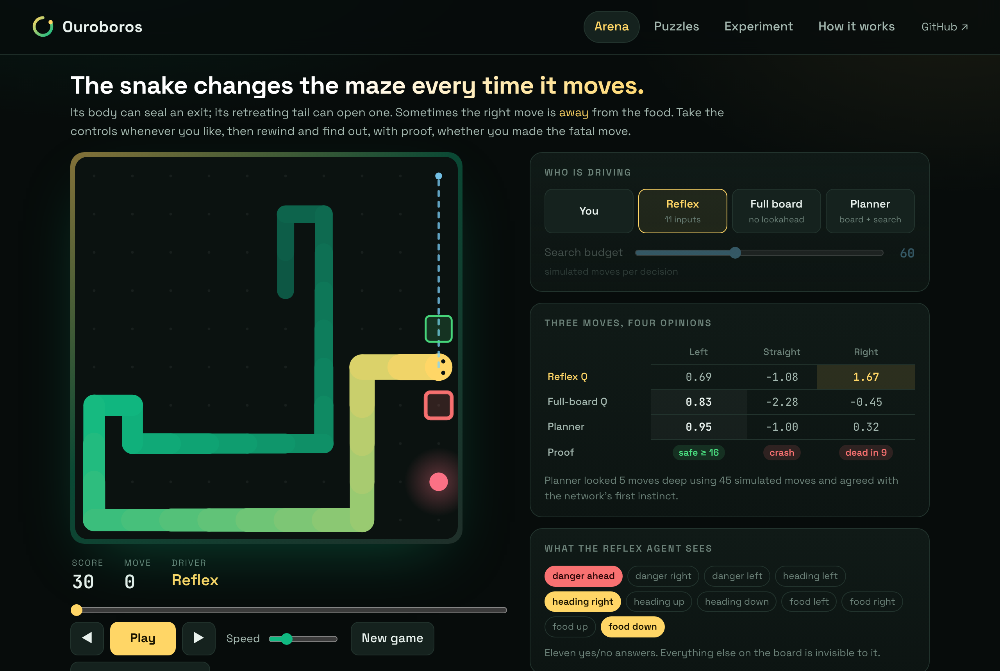

# Ouroboros

**A Snake AI that learns when the food is a trap.**

[](https://github.com/Aliyousefi9403/ouroboros/actions/workflows/tests.yml)

**[Play it in your browser →](https://aliyousefi9403.github.io/ouroboros/)**



In Snake, the snake changes the maze every time it moves. Its body can seal an
exit, and its retreating tail can open one. Sometimes the best move is to turn
*away* from the food and follow the tail until a route clears.

Ouroboros is a playable reinforcement-learning project built around that idea.
You can challenge a Snake AI, freeze the game at any move, take the controls,
rewind, and ask a question most game AIs cannot answer honestly:

> **Could I have survived?**

The answer is not a guess from a neural network. The engine enumerates every
legal continuation of your move with the real game rules and the real food
sequence. If all of them end in a collision, your move was provably fatal and
you are shown the move that was not. If the search cannot finish, it says so.
A bad outcome alone never counts as proof of a bad move.

## The question

**When Snake makes a better decision, how much comes from seeing more of the
board, and how much comes from thinking further ahead?**

Four agents play the same held-out games (same start, same food sequence, seeds
never used in training):

| Agent | What it sees | Lookahead |
|---|---|---|
| **Reflex** | 11 yes/no inputs (the classic tutorial agent) | none |
| **Full board** | the whole grid, body in head-to-tail order | none |
| **Full board + search** | the whole grid | *B* simulated moves, ranked by its own value estimate |
| **Search only** | no learning at all | the same *B* simulated moves, ranked by a distance heuristic |

<!-- RESULTS -->

## What is in here

| Piece | Where | What it does |
|---|---|---|
| **A neural network from scratch** | [`ouroboros/nn.py`](ouroboros/nn.py) | Forward pass, hand-derived backpropagation, Huber loss and Adam in plain NumPy. Gradients are checked against finite differences. Trains the 11-input reflex agent. |
| **A full-board agent** | [`ouroboros/models.py`](ouroboros/models.py), [`features.py`](ouroboros/features.py) | A small convolutional Q-network over the egocentric board. The body is encoded as *moves until this square clears*, which is what tells the agent which walls are about to open. |
| **A planner** | [`ouroboros/search.py`](ouroboros/search.py) | Beam search under a hard budget of simulated moves, using the network's value estimate to rank the frontier. Fully batched: one call plans for hundreds of games. |
| **A proof engine** | [`ouroboros/verify.py`](ouroboros/verify.py), [`docs/js/verify.js`](docs/js/verify.js) | Exhaustive survival analysis with three honest verdicts: *survives* (with a witness line), *doomed* (every continuation collides), *unknown*. |
| **A puzzle generator** | [`ouroboros/puzzles.py`](ouroboros/puzzles.py) | Mines games for pairs of positions with identical 11-input observations but disjoint sets of surviving moves, and for positions where the reflex agent's move is provably fatal. |
| **A replay engine** | [`ouroboros/engine.py`](ouroboros/engine.py), [`docs/js/engine.js`](docs/js/engine.js) | Deterministic, batched, and identical in Python and JavaScript. A seed plus a move list reproduces any game, so every position can be rewound, branched and shared as a link. |

### Design notes

**The board is a time-to-live grid.** Each cell stores the number of moves until
it is vacated: 0 for empty, 1 for the tail tip, `length` for the head. One array
therefore holds the body *in order*, a move is a single vectorised update
(decrement, write the new head), and the collision rule falls out exactly: a cell
is deadly only if it is still occupied after the tail has moved. The same array,
divided by the board area, is the network's input plane.

**Everything is batched.** The engine state is a handful of NumPy arrays with a
leading batch axis. The same `step` function drives one interactive game, 128
parallel training games, the thousands of futures the planner simulates, and the
frontier of the proof search. It runs at about a million moves per second on a
single CPU core.

**The browser runs the research code, not a re-imagining of it.** The JavaScript
engine, both networks, the planner and the proof search are line-for-line ports,
and [`tests/parity.test.mjs`](tests/parity.test.mjs) holds them to it: games
replay bit for bit, network outputs match to 1e-4, planner decisions and proof
verdicts are identical. There is no build step and no framework.

**Two-board puzzles are a proof about information, not about one agent.** If two
positions produce the same 11 numbers and no move survives both, then *every*
policy that only sees those 11 numbers loses at least one of them, however it
was trained.

## Run it

```bash
pip install -r requirements.txt
```

```bash
python -m pytest -q tests && node --test tests/parity.test.mjs
```

```bash
python -m http.server 8000 --directory docs
```

Then open http://localhost:8000. The site is static; GitHub Pages serves it
straight from `docs/`.

### Reproduce everything

```bash
python -m ouroboros.train reflex        # under a minute on a CPU
python -m ouroboros.train board         # about 40 minutes on 4 cores
python -m ouroboros.experiment          # the held-out comparison
python -m ouroboros.puzzles             # mine traps and two-board puzzles
python scripts/export_web.py            # weights for the browser
python scripts/make_fixtures.py         # refresh the Python/JS parity fixtures
```

Trained weights are committed under `models/`, so the experiment and the site
work without retraining.

## How the proof works

For a position and a first move, the engine expands every legal continuation
level by level, up to a horizon of 16 moves:

- **survives**: some line is still alive at the horizon. The line itself is the proof.
- **doomed**: the frontier is empty before the horizon. Every line was checked.
- **unknown**: the frontier outgrew its budget and was thinned. A thinned search
  can still prove survival, because a witness is a witness, but it is never
  allowed to claim doom.

After a crash, the site walks the played line backwards to find the *point of no
return*: the last move before which an escape still existed and after which none
did. That is the difference between "you died six moves later" and "this move
killed you".

## Limits

- The board is 10×10. The engine is size-agnostic, but the committed weights are not.
- A 16-move horizon is long enough to catch every trap the agents fall into in
  practice, but "survives 16 moves" is not "safe forever", and the site words it
  that way.
- The planner knows the food stream, because the stream is part of the game
  state. That is the same information the proof engine uses, and it is what
  makes a rewind an exact replay rather than a similar game.

## License

MIT
